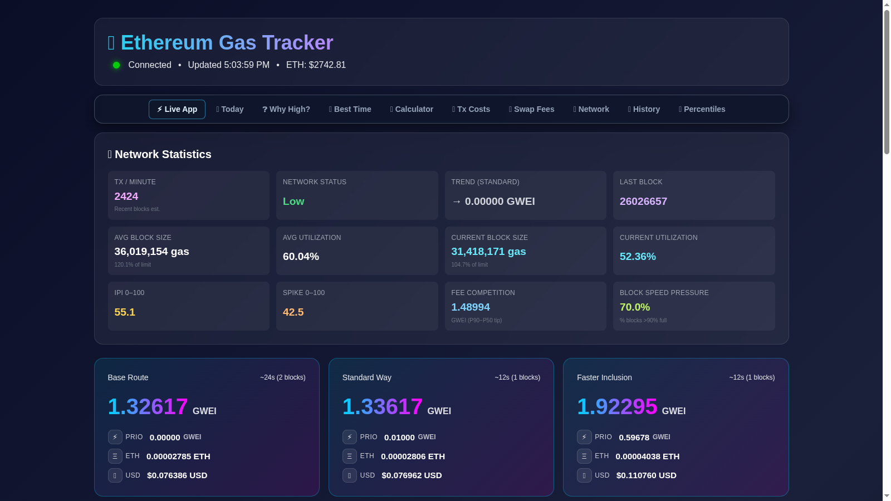

# ETH Gas Live — Fee Intelligence

Planning an Ethereum transaction takes more than one gas number. ETH Gas Live is the service behind the [Ethereum Gas Tracker](https://logicencoder.com/ethereum-gas-tracker/): it reads fees from the Ethereum network about once per block, serves three fee tiers in gwei with ETH and USD cost, keeps a history of up to 30 days, estimates the cost of 19 common transaction types and lets a visitor set a gwei threshold to be warned about. It is built for anyone who sends transactions and wants to know whether to go now or wait.

## Tech stack

| Layer | Technologies |
|---|---|
| Service | Python with FastAPI, a WebSocket feed for live updates and Web3.py for the node connection |
| Ethereum source | A local Geth node by default, or a hosted RPC provider (Ankr, Infura, Alchemy, QuickNode or dRPC) chosen at start |
| History | SQLite with cached history responses |
| Page rendering | A Node.js and Express server that renders the tracker page with React on the server, and Chart.js charts in the browser |
| Publishing | The pages are also delivered through the companion WordPress plugin |

## Fee tiers

The tracker shows three tiers: Base Route, Standard Way and Faster Inclusion, each in gwei together with the equivalent cost in ETH and USD for a plain transfer, using the latest ETH price. Values refresh about every 12 seconds, which matches the block interval, and arrive in the open page over the WebSocket feed instead of through polling. A send-now or wait hint compares the current Standard Way fee with the recent average and trend.

## Network context

Beside the tiers the page shows what is behind them: block utilisation, a pressure index and a spike score that flag a short surge, and a status of low, normal or high with a plain-language explanation. The Gas Intelligence Hub gathers these with recent averages in one panel. The figures describe conditions and relative pressure; they do not promise how fast the next transaction will be included.

## History and statistics

History can be requested for any window up to 720 hours, which is 30 days, and the same data feeds statistics for a chosen window and an hour-by-day heatmap of average fees over the last days. The heatmap shows which hours of the week were cheap in the past, with the average fee converted to ETH and USD for a 21,000-gas transfer. Charts draw several tiers together, and responses are cached so a busy page does not repeat the same database query.

## Transaction cost estimates

Featured actions turn the live fee into a cost for 19 transaction types. They include ETH and token transfers, token approvals, DEX swaps, NFT sales and mints, bridging, borrowing, lending, staking, unstaking, reward claims, compounding, adding and removing liquidity, governance votes, multi-send and contract creation or deployment. Each has a low, typical and high gas amount, so the visitor sees a range in ETH and USD rather than a single guess. The gas amounts are fixed typical values, not a simulation of a specific transaction.

## Alerts

A visitor sets an over or under threshold in gwei; the threshold is stored against the browser session and checked against each new reading. When it triggers, the page shows an in-page message and a browser notification if the visitor allowed notifications. A session's alerts can be listed and each one deleted. They work while the page is open and the browser permits notifications.

## Pages and search

Besides the tracker, the service renders information pages for the questions people search: today's gas fees, why fees are high, the best time to send, a gas calculator, transaction costs, swap gas fees, a mempool tracker, network status, price history and gas percentiles. These pages use the same live numbers as the tracker, so a visitor who arrives from search sees current values.

## Operations

A monitoring overview endpoint reports runtime counters, such as history requests, history cache hits and the number of connected live clients, and a health endpoint reports whether the service is up. Two administrator-only routes purge stored history when the database has to be reset. The counters help separate a pause in reading the node from a problem delivering pages.

---

Private code: [eth-gas-live-backend](https://github.com/logicencoder/eth-gas-live-backend)

[WordPress gas dashboard](https://github.com/logicencoder/eth-gas-live-plugin-overview)

See [REPOS.md](REPOS.md) for related repositories.

**[Logic Encoder](https://logicencoder.com)** · [GitHub](https://github.com/logicencoder) · [Contact](https://logicencoder.com/contact/)
